  

<!-- GitHub READMEs cannot set page-wide CSS background/text colors.
     This full-width SVG gives the content its own uninterrupted dark background.
     Language percentages and stats are regenerated by GitHub Actions. -->
