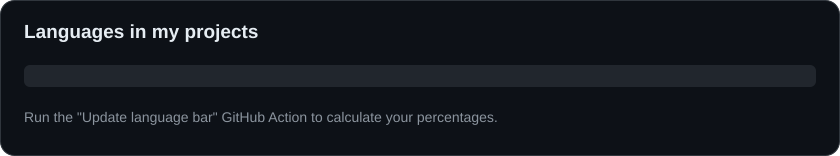

<svg xmlns="http://www.w3.org/2000/svg" width="840" height="156" viewBox="0 0 840 156" role="img">
  <rect x="0.5" y="0.5" width="839" height="155" rx="14" fill="#0D1117" stroke="#30363D" />
  <text x="24" y="38" fill="#E6EDF3" font-family="Arial, sans-serif" font-size="19" font-weight="bold">Languages in my projects</text>
  <rect x="24" y="65" width="792" height="22" rx="6" fill="#21262D" />
  <text x="24" y="122" fill="#8B949E" font-family="Arial, sans-serif" font-size="14">Run the "Update language bar" GitHub Action to calculate your percentages.</text>
</svg>

<h1 align="center">Hi 👋, I'm Bertus</h1>
<h3 align="center">A passionate developer from South Africa</h3>

  

- 🔭 I’m currently working on **Improving my coding skills 💡**
- 🌱 I’m currently learning **CS50!**
- 👯 I’m looking to collaborate on **Nothing.**
- ⚡ Fun fact **I am 17.**

<h3 align="left">Connect with me:</h3>

  
  

<h3 align="left">Languages and Tools:</h3>

  
  
  
  
  

<h3 align="left">Languages Used in My Projects:</h3>

  

<h3 align="left">GitHub Stats:</h3>

  

  &nbsp;
  

  

