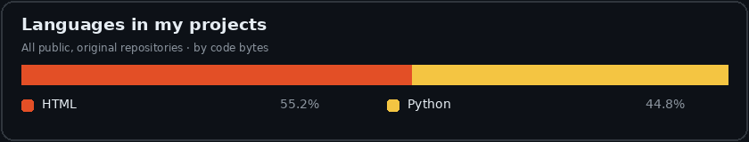
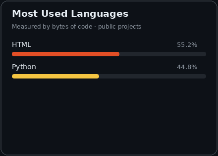
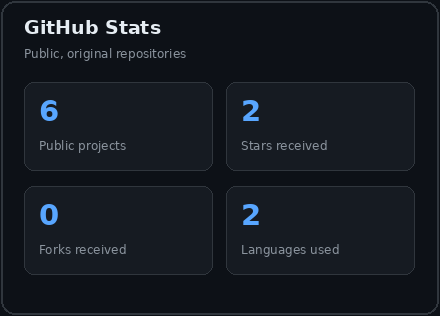

  

  
  
  
  

  

## about me

- 🔭 currently working on **CS50x problem sets**
- 🌱 currently learning **CS50x**
- 👯 looking to collaborate on **nothing yet**
- 🤝 looking for help with **nothing yet**
- ⚡ fun fact: **I'm 17**

## stack

  
  
  

## project language breakdown

  

## stats

  
  

